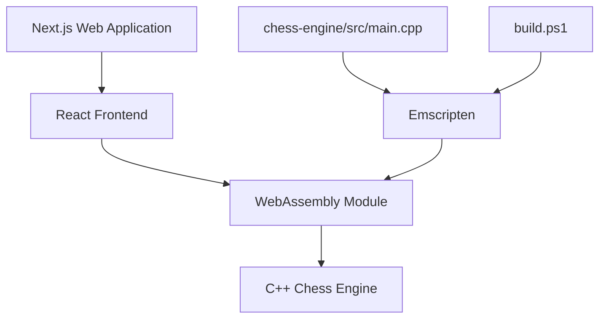

# ♟️ Chess++

**A chess engine written in C++, compiled to WebAssembly, and powered by a Next.js web interface.**

Chess++ brings together native C++ development and modern web technologies to make a chess engine accessible directly through the browser.

The project uses **Emscripten** to compile the C++ engine into WebAssembly, allowing the engine to run in a web environment alongside a Next.js frontend.

---

## ✨ Project Overview

Chess++ consists of two primary components:

- **Chess Engine:** A C++ implementation contained in `chess-engine/src/main.cpp`.
- **Web Application:** A Next.js application built with React and TypeScript that provides the browser-based interface.

Emscripten bridges the two by compiling the C++ engine into browser-compatible WebAssembly.

## 🏗️ Architecture



### How It Works

1. The chess engine is implemented in C++.
2. Emscripten compiles the engine into WebAssembly.
3. The generated WebAssembly build is used by the Next.js application.
4. The browser runs the web application and loads the compiled engine.

This approach allows the project to use C++ for its engine while leveraging the flexibility of a modern web application.

---

## 📁 Project Structure

```text
chess-plus-plus/
│
├── chess-engine/
│   ├── src/
│   │   └── main.cpp       # Main C++ chess engine implementation
│   │
│   └── build.ps1          # Emscripten build script
│
├── emsdk/                 # Emscripten SDK
│
└── web/
    ├── package.json       # Next.js dependencies and scripts
    ├── ...                # Next.js application source
    │
    └── ...
```

### Directory Breakdown

| Directory / File | Description |
|---|---|
| `chess-engine/src/main.cpp` | Main implementation of the chess engine |
| `chess-engine/build.ps1` | PowerShell script for compiling the engine using Emscripten |
| `emsdk/` | Emscripten SDK and WebAssembly compilation tools |
| `web/` | Next.js frontend application |
| `web/package.json` | Frontend dependencies and development scripts |

---

## 🛠️ Technologies

| Technology | Purpose |
|---|---|
| C++ | Chess engine implementation |
| Emscripten | Compiling C++ into WebAssembly |
| WebAssembly | Running the compiled engine in the browser |
| Next.js 16 | Web application framework |
| React 19 | Frontend UI |
| TypeScript | Frontend development |
| Tailwind CSS 4 | Frontend styling |
| PowerShell | Engine build automation |

---

## 🚀 Getting Started

### Prerequisites

Make sure you have the following installed:

- [Git](https://git-scm.com/)
- [Node.js](https://nodejs.org/)
- npm
- [Emscripten](https://emscripten.org/docs/getting_started/downloads.html)
- Windows PowerShell (for the provided `build.ps1` script)

### 1. Clone the Repository

```bash
git clone https://github.com/DestroyerX7/chess-plus-plus.git
cd chess-plus-plus
```

### 2. Build the Chess Engine

The chess engine is written in C++ and compiled into WebAssembly using Emscripten.

First, navigate to the Emscripten SDK directory:

```powershell
cd emsdk
```

Activate the Emscripten environment:

```powershell
.\emsdk_env.ps1
```

> This configures the current terminal session so that Emscripten compiler tools are available.

Next, navigate to the chess engine directory:

```powershell
cd ..\chess-engine
```

Run the build script:

```powershell
.\build.ps1
```

This compiles the C++ chess engine into WebAssembly for use by the web application.

**Whenever you modify `chess-engine/src/main.cpp`, repeat the build process to regenerate the WebAssembly output.**

### 3. Install Web Dependencies

Navigate to the web directory:

```powershell
cd ..\web
```

Install the required dependencies:

```bash
npm install
```

### 4. Start the Development Server

Run the Next.js development server:

```bash
npm run dev
```

Once the server starts, open:

**http://localhost:3000**

You should now be able to access the Chess++ web application locally.

---

## 💻 Development Workflow

The project separates engine development from frontend development.

### Working on the Chess Engine

The main engine implementation is located at:

```text
chess-engine/src/main.cpp
```

To make changes:

1. Modify `main.cpp`.
2. Run `build.ps1` from the `chess-engine` directory.
3. Allow Emscripten to compile the updated engine.
4. Run the web application to test the changes.

### Working on the Web Application

The frontend lives inside:

```text
web/
```

Navigate to the directory and start the development server:

```bash
npm run dev
```

Next.js provides a development environment with automatic updates as frontend files change.

### Available npm Scripts

Run these commands from the `web` directory.

| Command | Description |
|---|---|
| `npm run dev` | Starts the development server |
| `npm run build` | Creates a production build |
| `npm run start` | Starts the production server |
| `npm run lint` | Runs ESLint |

---

## 🔧 Building for Production

To create a production build of the frontend:

```bash
cd web
npm run build
```

After a successful build, start the production server:

```bash
npm run start
```

The C++ engine should be compiled with Emscripten before building the frontend so that the latest engine artifacts are available to the application.

---

## 📄 License

See the repository for licensing information.

---

<p align="center">
  <b>Chess++</b>
  <br/>
  Built with C++ ♟️
  <br/>
  Powered by WebAssembly and Next.js
</p>